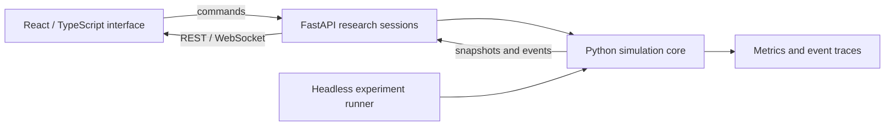

# WareTwin

**A warehouse coordination laboratory for multi-zone order preparation, shared conveyors and packing.**

WareTwin is an active software engineering and research project. Its Python simulation core is the source of operational state; an interactive React/TypeScript interface and a headless experiment runner use the same event model. It is a local research prototype, with deployment and access-control work still required.

## What is implemented

- Zone agents coordinate picking, robot availability, local buffers, conveyor reservations, order consolidation and packing.
- Five policies share the same resource rules: `fifo`, `order_aware`, `gwo_conveyor`, `local_search` and `gwo_integrated`.
- Seeded scenarios cover demand imbalance, multi-zone orders, restricted buffers and resource interruptions.
- Research sessions support pause, resume, single-step execution, order injection, disruptions and trace exports.
- A separate warehouse/store mode preserves the existing 3D navigation, lifts, robot fleet and commerce flows. Its metrics are separate from research experiments.

GWO is a heuristic; the implementation does not guarantee an optimal schedule. Duration prediction uses physical timing and historical averages. A learned ML predictor is future work.

## Architecture



The browser displays server snapshots rather than running an independent research engine. Fixed evaluation budgets and separate scenario/algorithm seeds support repeatable comparisons. The optional wall-clock search limit is a soft live limit and should be omitted for reproducibility.

## Run locally

Use Python 3.11+ and Node.js 20+. Run these commands from the repository root:

```bash
python3 -m venv apps/api/.venv
apps/api/.venv/bin/python -m pip install -r apps/api/requirements-dev.lock
npm --prefix apps/web ci
bash start.sh large
```

Open the research interface at `http://127.0.0.1:5173/#research`, the warehouse at `http://127.0.0.1:5173/#warehouse`, or API documentation at `http://127.0.0.1:8000/docs`.

To run only the research API and web client, use two terminals:

```bash
apps/api/.venv/bin/python -m uvicorn apps.api.research:app --host 127.0.0.1 --port 8000
npm run dev:web
```

For Windows, use the `apps/` paths and the existing `dev.ps1` launcher. The `backend` and `frontend` compatibility links point to `apps/api` and `apps/web`.

### Configuration

See [`apps/api/.env.example`](apps/api/.env.example) and [`apps/web/.env.example`](apps/web/.env.example). The local rule-based/simulated paths do not require an AI API key. Keep credentials in ignored local environment files. Public hosting needs authentication, explicit allowed origins and persistent result storage; CORS is not authentication. Run one API worker because research sessions live in server memory.

## Reproducible experiments

```bash
# One seeded run
apps/api/.venv/bin/python -m apps.runner run --scenario multi_zone --policy fifo --seed 42

# Small comparison across all five policies
apps/api/.venv/bin/python -m apps.runner batch --scenario balanced --policy all --seeds 2 --budget 6

# Analyse a completed batch
apps/api/.venv/bin/python experiments/analyze.py experiments/results/RUN_DIRECTORY/summary.csv
```

Runs produce configuration, seeds, version information, order/event/decision traces and metrics under ignored `experiments/results/`. Web exports also include user commands. Active sessions are in memory; completed/reset sessions are archived to the result directory. Open orders are reported separately from completed-order averages.

## Validate

```bash
apps/api/.venv/bin/python -m pytest tests apps/api/tests -q
npm run test:web
npm run build
apps/api/.venv/bin/python scripts/export_contracts.py --check
# Combined local validation
npm run validate
```

Tests cover conservation rules, resource ownership, reservations, disruptions, reproducibility, API/runner parity and the preserved navigation/commerce engine. CI executes backend and frontend checks; inspect the Actions result for the commit being reviewed.

## Repository map

| Path | Purpose |
| --- | --- |
| `packages/warehouse_core/` | Domain, simulation, coordination, resources, scheduling, policies and telemetry |
| `packages/warehouse_core/legacy/` | Preserved navigation, fleet, lift and commerce simulation |
| `packages/contracts/` | Python, TypeScript and JSON contracts |
| `apps/api/` | FastAPI services and API regression tests |
| `apps/web/` | React interface and 3D views |
| `apps/runner/` | Single-run and batch experiment CLI |
| `experiments/` | Scenarios and paired-seed analysis |
| `tests/`, `docs/`, `validation/` | Core tests, design documentation and historical validation records |

## Scope and next work

The research model uses a one-way, fixed-speed shared belt, equal-size carriers and dedicated robot service lanes. General robot path collisions, research-mode lift scheduling, replenishment and distribution after shipping are outside this model. Charging is a task-count approximation. Simulation steps default to 0.5 seconds and durations are rounded upward.

Future work includes measured learned duration prediction, expanded physical models and deployment hardening. Existing screenshots and validation logs document particular revisions and should not be read as current benchmark guarantees.

[Architecture](docs/architecture.md) · [Experiment protocol](docs/experiment-protocol.md) · [Scenario format](docs/scenarios.md) · [Warehouse interface](docs/warehouse-ui.md) · [Türkçe](README.tr.md) · [MIT license](LICENSE)
