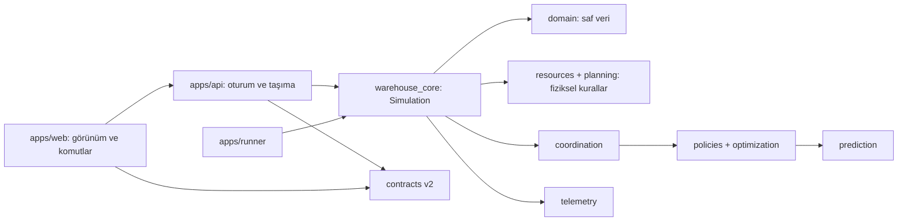

# Mimari ve durum sahipliği

## Bağımlılık yönü

Domain `dataclass` modelleri yalnızca standart Python kullanır. Çekirdek FastAPI,
Pydantic, React, Three.js veya tarayıcı saatine bağımlı değildir. API iş kuralları
uygulamaz; komutu doğrular, oturum kilidi altında çekirdeği çağırır, snapshot yayınlar.
CLI aynı sınıfı çağırır. Web'deki Zustand durumu yalnızca son snapshot, bağlantı
ve seçimdir. Ekrandaki interpolasyon dünya durumunu geri yazmaz.

## Kavramlar ve birimler

- `Order`: geliş, teslim hedefi, gerekli ürün kimlikleri, paketleme ve bitiş zamanı.
- `Item`: bir fiziksel ürün birimi; tek yetkili konum alanı vardır.
- `PickTask`: ürün toplama görevi, robot ataması ve tamamlanma zamanı.
- `Carrier`: bu ürünü ortak banda taşıyan tek taşıyıcı. Müşteri paketi değildir.
- `CustomerPackage`: tüm bileşenler geldikten ve paketleme bittikten sonra oluşur.
- `Robot`, `PackingStation`: bir anda en çok bir işe sahip kaynaklar.
- Zaman: simülasyon saniyesi (`*_s`), ayrık adım sayısı (`tick`). Mesafe metre;
  hız m/s; kapasite taşıyıcı/ürün birimi yuvası. Karar hesaplama `compute_ms`
  bilgisayar duvar zamanıdır ve sipariş tamamlanma süresine eklenmez.

Her ürün için bir görev, en çok bir taşıyıcı ve tam bir son paket üyeliği korunur.
Bütün sipariş için birleştirme yuvaları kabul anında atomik ayrılır; paketleme
bitene kadar serbest bırakılmaz. Böylece yarım siparişler alanı karşılıklı kilitlemez.
Toplama başlamadan yerel tampon yuvası ayrılır; taşıyıcı banda girince serbest kalır.

## Adım sırası

1. O ana kadar gelen siparişler ve senaryo kesintileri uygulanır; süresi biten
   kesintiler kaldırılır.
2. Gerekirse global öncelikler yeniden hesaplanır. Sipariş kabulü ve bölge
   agent'larının görev ataması gerçekleştirilir.
3. Geçerli rezervasyonlar hazırlanır; hazır ürünler fiziksel giriş denetiminden
   geçer. Eksiksiz siparişler boş paketleme istasyonuna alınır.
4. Saat bir adım ilerler. Robot, bant ve paketleme kaynaklarının işlemleri ilerler.
   Bitiş olayları aralığın sonuna damgalanır.
5. Korunum, kapasite, mesafe, robot sahipliği ve işlem sırası invariant'ları
   doğrulanır. Kuyruk/doluluk örnekleri kaydedilir.

Robot akışı: IDLE → ASSIGNED → MOVING_TO_PICK → PICKING → CARRYING → DROPPING
→ IDLE/CHARGING. FAILED mevcut aşama, kalan işlem ve yükü korur. Onarımda aynı
işe devam edilir; ikinci bir kopya görev oluşturulmaz. Şarj, görev sayısı eşiğiyle
başlayan basit bir servis süresidir. İlk araştırma modelinde robotlara ayrılmış
bağımsız koridorlar vardır; genel çok robotlu yol bulma bu modelin parçası değildir.

## Konveyör çizelgeleme

Bant konumu `0..belt_length_m`, bölge girişi `entry_m` olarak tanımlanır. Her
rezervasyon, giriş ve bütün sonraki birleşme/çıkış noktalarındaki geçiş zamanını
saklar. Minimum baş mesafesi `(carrier_length_m + safe_gap_m) / belt_speed_mps`
saniyedir. Aday giriş zamanı, herhangi bir ortak noktadaki çatışma giderilene kadar
ileri taşınır. Hedef sipariş için birleştirme kapasitesi yoksa rezervasyon oluşmaz.
Bütün noktalar doğrulanmadan rezervasyon defteri değiştirilmez; ufuk aşımında
kısmi rezervasyon kalmaz. Sabit hız ve tek yön, aynı segmentte güvenli mesafeyi
birleşme geçişlerinin zaman ayrımıyla korur. Girişte ikinci bir gerçek konum
kontrolü de vardır. Çıkış transferinden sonra bir takip aralığı boyunca açıklık
rezervasyonu tutulur; hedefe çok yakın girişler de bu aralığı atlayamaz.

Bant durunca bekleyen rezervasyonlar iptal edilir; aktif taşıyıcılar durur. Yeniden
başlamada aktif rezervasyonlar gerçek konumlardan hesaplanır. Tahmini hazırlama
giriş zamanını aşarsa ilgili rezervasyon bağlı olsa da düzeltilir. Gelecekteki
revizyon sayısı ve zamanı geldiğinde gerçekten kaçırılan rezervasyon sayısı ayrı
tutulur.

## Koordinasyon ve arama

Bölge agent'ı görev kuyruğu, robotlar, tampon doluluğu ve hazır olma tahminini
sunar. Global koordinatör sipariş kabulü, hazırlama ve bant önceliklerini yönetir.
Robot seçimi bütün politikalarda sabittir: en kısa raf yolu, en az tamamlanmış
şarj döngüsü görevi, robot kimliği. Hazırlama sırası ve robot seçimi ayrı işlemlerdir.

Yeni sipariş, bileşen gelişi, kapasite açılması, gecikme veya kesinti yeniden
planlamayı tetikler; ayrıca yapılandırılabilir periyodik kontrol vardır. Başlamış
robot işleri değişmez. Bantta kabul edilmiş taşıyıcılar değişmez. Yakın gelecekteki
geçerli girişler `commitment_s` içinde korunur; fiziksel uygunsuzluk üstün gelir.
Atama o anda uygulanır; ayrıca ileri zamanlı robot atama rezervasyonu yoktur.

Çözüm `Priorities(preparation, conveyor)` şeklindedir. GWO'nun rastgele anahtar
kodlaması ayrı `representation` modülündedir. FIFO ve sipariş odaklı kural aynı
çizelgeleyiciyi kullanır. Konveyör GWO hazırlamayı FIFO sabitler. Yerel arama iki
sırada takas komşuluklarını, bütünleşik GWO iki sıranın rastgele anahtarlarını arar.
Önceki planın hâlâ ilgili görevleri yeni görevlerle tamamlanarak başlangıç adayıdır.
En iyi fiziksel uygun aday ayrıca tutulur. Aday bulunamazsa referans öncelikleri
aynı güvenlik denetiminden geçirilerek uygulanır.

Aday değerlendirmesi canlı motoru kopyalar; olay/karar kayıtlarını taşımaz,
gelecek sipariş ve kesintileri çıkarır, henüz gözlenmemiş toplama süresini
fiziksel/geçmiş tahminle değiştirir. O anda açık olan aynı sipariş kümesi bütün
adaylarda kullanılır. Tamamlanmamış siparişler yaş + ufuk cezası alır; çıkarılmaz.
Durum veya rastgelelik akışı gerçek simülasyona geri yazılmaz.

## API ve uyumluluk

REST komutları kimlik taşır; aynı kimlik/aynı içerik tekrar uygulanmaz. Farklı
aynı kimlikli içerik reddedilir. STEP yalnızca duraklatılmış oturumda geçerlidir.
WebSocket tam, sürümlenmiş snapshot gönderir; revision eski yanıtların yeni durumu
ezmesini engeller. RESET generation artırır. Oturum kilidi API, arka plan adımlama
ve dışa aktarmayı seri hale getirir. Arama/adımlama worker thread'inde çalışır;
web olay döngüsü iş kurallarını içermez.

`legacy` eski 100 ms navigasyon modelidir. 1.725 satırlık motor; başlangıç/adımlama,
fleet, lifts, navigation, monitoring ve runtime modüllerine bölündü. Eski mağaza
operasyon geçişleri `legacy/order_flow.py` içine taşındı; SQLite katalog ve kalıcılık
adaptörü API'de kaldı. Eski TypeScript motoru yalnızca korunmuş regresyon karşılığıdır;
üretim arayüzü onu çağırmaz. Araştırma modeliyle legacy KPI'ları eşdeğer sayılmaz.
